> **Study area:** Principality of Asturias, Spain — 78 concejos (municipalities), ≈ 10 600 km².
> **Working CRS:** ETRS89 / UTM zone 30N (EPSG:25830), ellipsoid WGS 84. Source data in WGS 84 (EPSG:4326 / OGC:CRS84).
> **Focus areas:** the Pajares pass (Lena, Asturias – Villamanín, León) and the south-west of Asturias.
> **Status:** complete, 2026-09-30.

# The Satellite, the Steelworks and the Pass
### A detective story told with QGIS on real data from Asturias

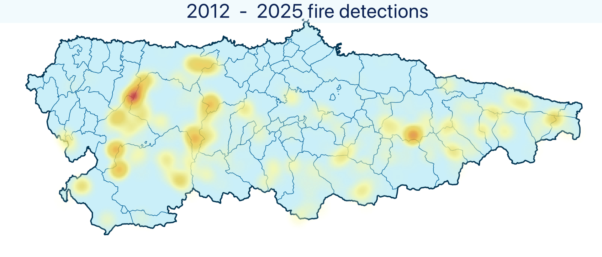

I took the **[Advanced QGIS](https://courses.spatialthoughts.com/advanced-qgis.html)** course by Ujaval Gandhi (Spatial Thoughts) and repeated the course exercises on **real data from Asturias**, the region where I live, instead of the course data.

Real data are not teaching data. They lie, hide things and set traps. This repository is not a polished solution. It is the **case file**: every clue, every wrong turn, every suspect and how each one was checked.

My results are not unique. **My mistakes are**, and I hope they save you some time.

*Elvira Gayanova — surveying engineer turning geospatial data engineer · [ElviraGD-lab](https://github.com/ElviraGD-lab)*
*QGIS 4.2.2 on macOS*

**▶ [Open the interactive map](https://elviragd-lab.github.io/asturias-advanced-qgis/)** — fire density in 5 km hexagons, click any cell.

---

## Contents

| Chapter | Case | Course section |
|---|---|---|
| 1 | The 370 missing kilometres | 1. Processing Toolbox |
| 2 | 1 598 names in one valley | 2. Batch Processing |
| 3 | A model that must work anywhere | 3. Model Designer |
| 4 | One road, two names | Assignment |
| 5 | The satellite sees fire — and so do I (wrongly) | 4. 2D Animations: data |
| 6 | 58 % of the fires are not fires | 4. 2D Animations: data |
| 7 | The fire that never moves | 4. 2D Animations: data |
| 8 | Two maps, two stories | 4.1, 4.1.1, 4.2, 4.3.1 |
| 9 | Same model, new suspects | 3 + 4 |
| 10 | Draw a corridor, get its alibi | 6. Aggregate expressions |
| 11 | The map that refused to load | Publishing with qgis2web |
| 12 | Over the Pajares pass | 5. 3D Animations |
| — | Lessons from this case | |
| — | Case closed · What the mistakes taught me | |
| — | Reproduce it, notes, credits | |

*Not covered: 4.3 (GPS track), 6.1.1 and section 7 (QGIS MCP) — outside the story of this case.*

---

## The case file — data

| Evidence | Source | Date | Licence |
|---|---|---|---|
| Roads, railways, rivers, place names | Geofabrik free extract, Asturias | 2026-09-15 | ODbL — © OpenStreetMap contributors |
| Municipality boundaries | Geofabrik extract, Asturias (`.osm.pbf`) | 2026-09-15 | ODbL — © OpenStreetMap contributors |
| Active fire detections | NASA FIRMS, VIIRS S-NPP 375 m, standard archive, request 810761, Spain | 2012-01-20 → 2026-09-22 | NASA FIRMS (acknowledgement below) |
| Terrain, 2 m | CNIG, MDT02 2nd coverage, sheets 0078-3 and 0103-1 (ETRS89 / UTM 30N) | 2020 | CC BY 4.0 — derived work, credit below |
| Method | Advanced QGIS, Ujaval Gandhi | — | CC BY 4.0 |

---

## Chapter 1 · The 370 missing kilometres
*Course section 1 — Processing Toolbox. The course uses the national highways of Karnataka; here, the Spanish state network (`A-`, `AP-`, `N-`) in Asturias.*

**First clue: 80 municipalities instead of 78.** The OSM extract included two neighbours touching the border: Negueira de Muñiz (Galicia) and Tresviso (Cantabria). Found by comparing the count with the official number, then every name with the official list.

**The ETL chain.** Extract by expression `regexp_match("ref", '^(A|AP|N)-')` → Add geometry attributes (ellipsoidal) → Field calculator → Basic statistics → Refactor fields: **3 385 segments, 1 664.09 km.**

**Trap 1 — degrees disguised as kilometres.** The first run gave a total of `0.0149` — 14.95 degrees, divided by 1 000 by the metres-to-kilometres formula. *Calculate using* was left on *Layer CRS*, so the lengths were in degrees. Sanity check: 1 664 km ÷ 14.95° ≈ 111 km per degree.

**Trap 2 — NULL that is not NULL.** The course expression `"name" is not null` kept all 3 385 roads. In Geofabrik GeoPackages a missing name is an **empty string**. Working filter: `"name" is not null and "name" != ''` → 2 906 roads; 479 have a number but no name.

**The mystery.** The same roads summed per municipality gave **1 293.87 km**. Where did **370 km** go?

Two suspects: roads outside Asturias in the extract buffer, or gaps between municipality polygons. **The experiment:** sum the lengths against one single polygon, the whole of Asturias. Result: **1 293 872.737 m**, identical to six decimals. No gaps. The 370 km lie outside the region, in the extract buffer.

**Trap 3.** *Sum line lengths* has no measurement setting. It silently uses the **project ellipsoid**, and with `None` it returns degrees.

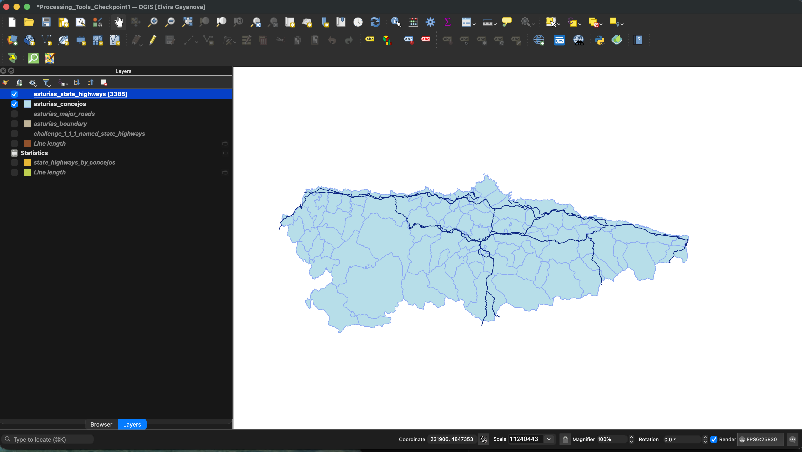

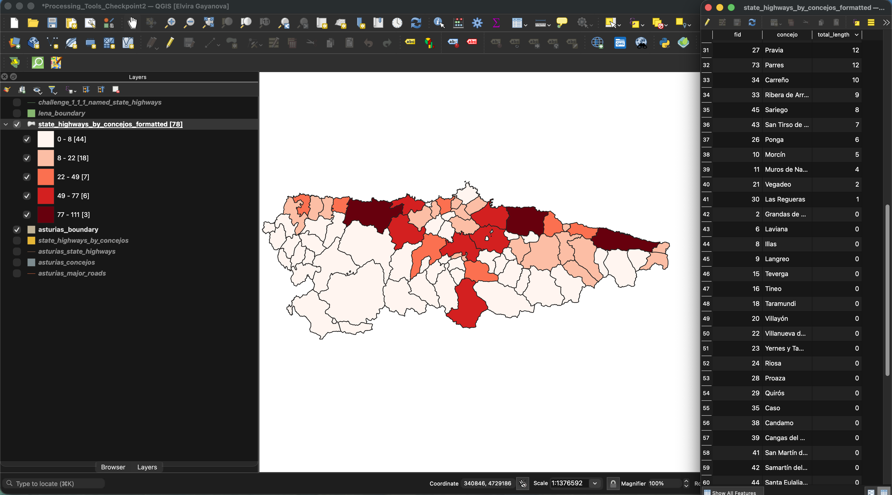

*44 of 78 municipalities fall in the lowest class (0–8 km); in 36 of them there are no state roads at all.*

---

## Chapter 2 · 1 598 names in one valley
*Course section 2 — Batch Processing. Clipping Asturian data to Asturias makes no sense, so the batch clip goes to one municipality: **Lena**, home of the Pajares pass.*

Five layers clipped at once: roads 2 836, railways 322 (the Pajares ramp, tunnels numbered up to 70), rivers 305, land use 1 123, and **1 598 place names**.

1 598 names in one mountain municipality looked like an error. Reading the content instead of the count solved it: almost all are `locality` with population 0 — named pastures, ridges and huts (*Mayéu, Ḷḷomba, Cabana*). The mountains are full of names, not people.

**Challenge 2.1.1:** reprojected to EPSG:25830. In QGIS 4.2 the batch dialog has no *Save to GeoPackage*; the workaround is *Package Layers*.

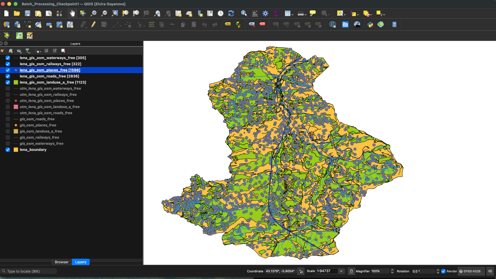

---

## Chapter 3 · A model that must work anywhere
*Course section 3 — Model Designer.*

Instead of a piracy-only model I built **`hexbin_density`**: any points + any base layer + a grid size → hexagonal density. It will be tested on a completely different suspect in chapter 9.

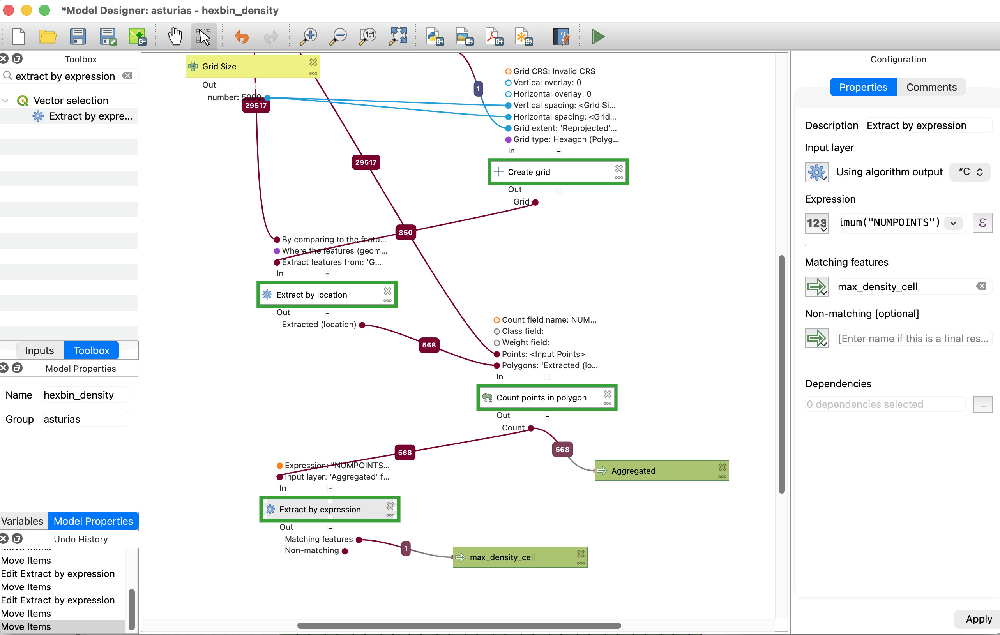

**On 29 517 place names, 5 km cells:** 850 cells, 568 with points. **The balance did not close:** the sum of `NUMPOINTS` was 29 513. The 4 missing points were found with a `disjoint` extraction: they lie on the Galician border, outside the grid extent.

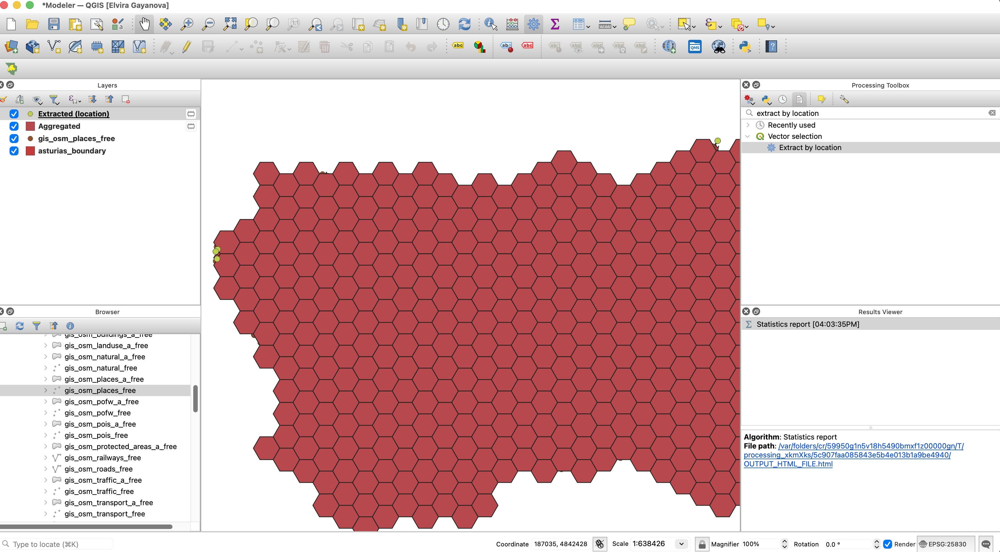

The densest cell holds **200 names**, in **Cabrales** (Picos de Europa): mountain places, no residents. A regular hexagon 5 km across covers **21.65 km²**, not 25.

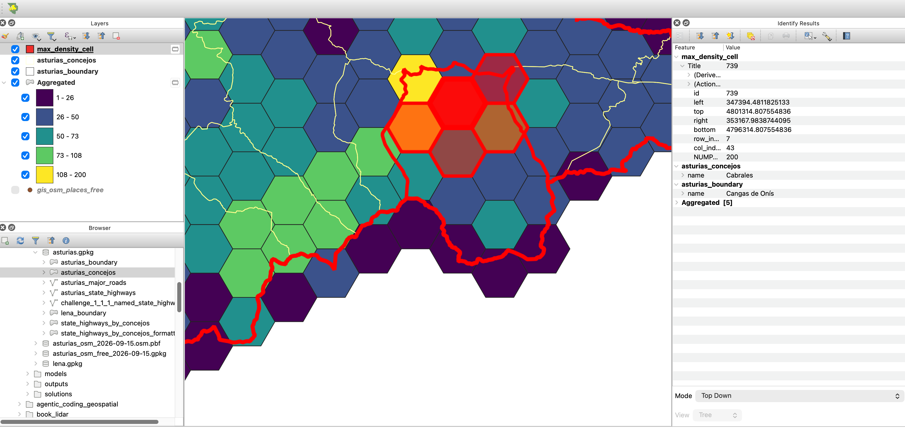

### 3.2 The spatial index — a prediction that failed
The course adds a spatial index to the grid. On my data that removed **no warning at all**. The log said something else:

| State | Model time | Warnings |
|---|---|---|
| no index | 3.32 s | `intersect layer`, `points layer` |
| index on the grid (course step) | 4.43 s | the same two |
| index on the grid **and on the points** | **1.45 s** | none |

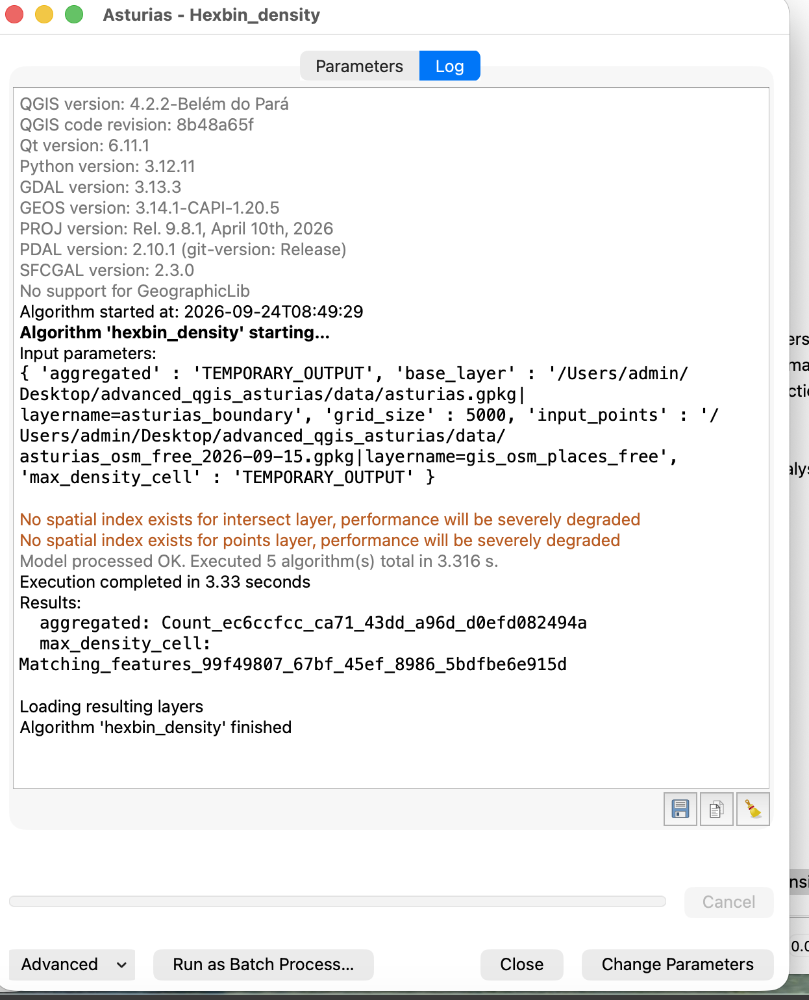
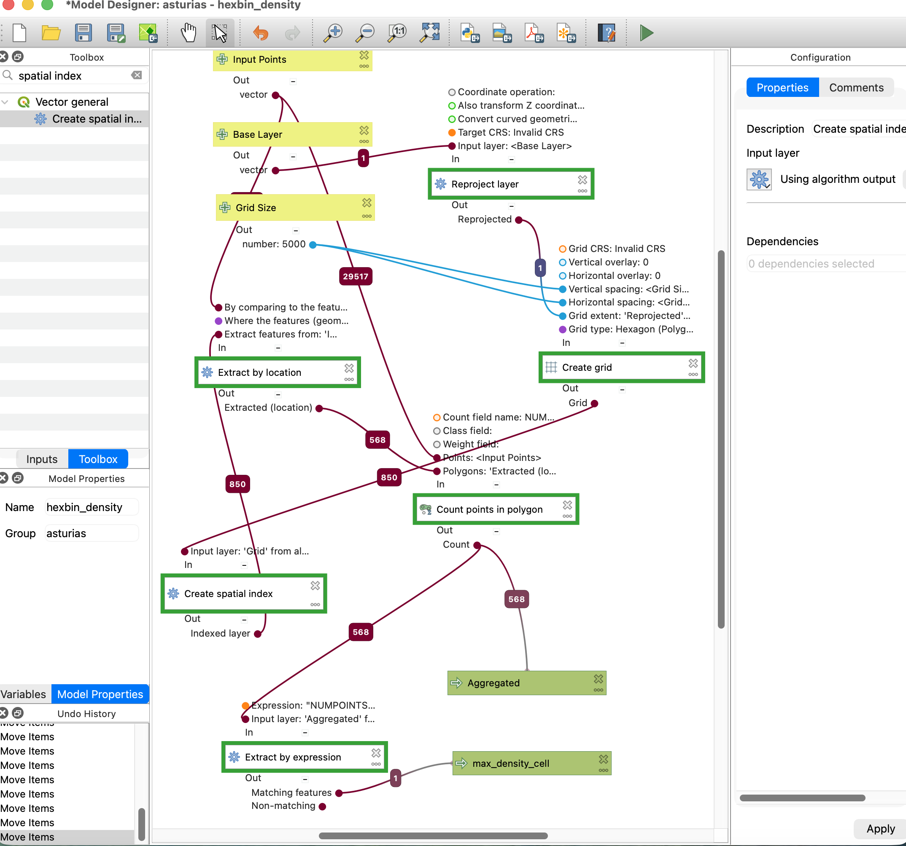

**Finding:** the Geofabrik GeoPackage ships **without a spatial index**. The heavy layer is the 29 517 points, not the 850-cell grid. Results unchanged.

### 3.2.1 Grid size in kilometres
`@grid_size * 1000` as a *Pre-calculated Value*. Check: 5 km → the same 850 cells; 10 km → **225** cells (predicted 210–230).

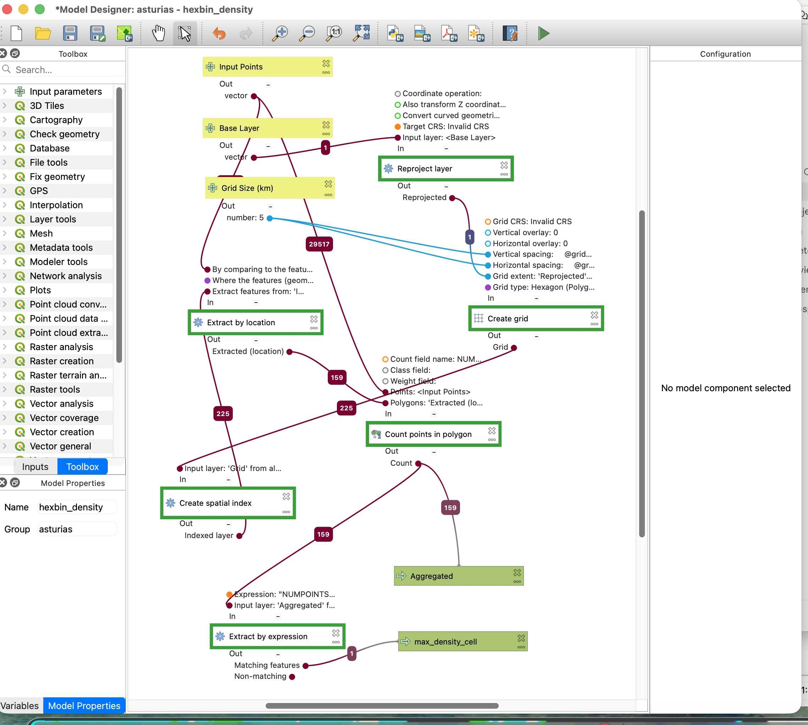

---

## Chapter 4 · One road, two names
*The course Assignment: a model `Calculate Highway Statistics` with an enum: state network (`A-`, `AP-`, `N-`) or regional network (`AS-`).*

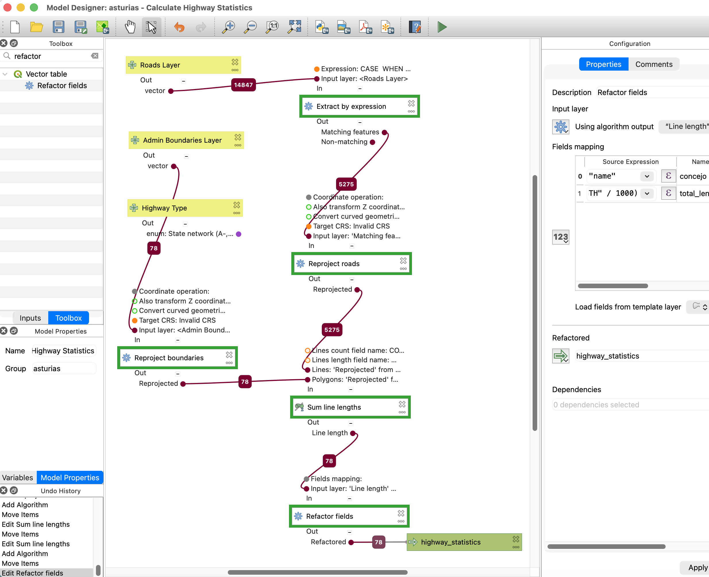

**The trap:** where two roads share a carriageway, OpenStreetMap writes both numbers: `AS-242;N-630`. A pattern anchored to the start of the text (`^N-`) misses the second road. On my data that lost **14 segments, 1 645 m — all in Lena, at the Pajares pass.** The fix: `(^|;)`.

**Independence test:** both inputs are reprojected inside the model, so it gives the same answer in a project set to EPSG:4326 with no ellipsoid.

| State network | Regional network |
|---|---|
| 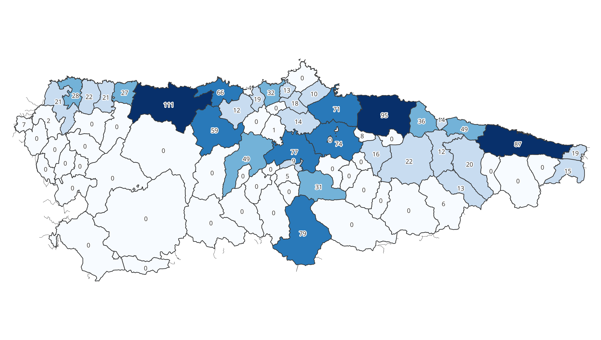 | 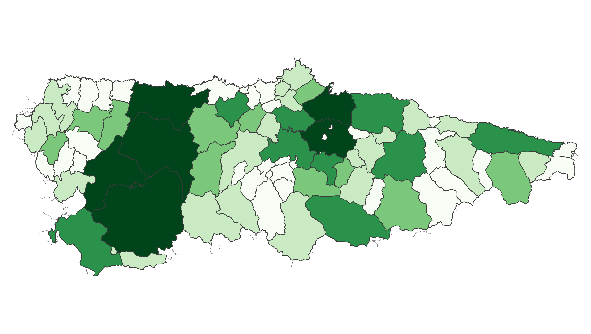 |
| 1 294 km in 42 of 78 municipalities | 2 845 km in 77 of 78 |

---

## Chapter 5 · The satellite sees fire — and so do I (wrongly)
*Course section 4 — 2D Animations. The course animates piracy attacks; here, 14 years of wildfire detections by the VIIRS sensor on the Suomi NPP satellite.*

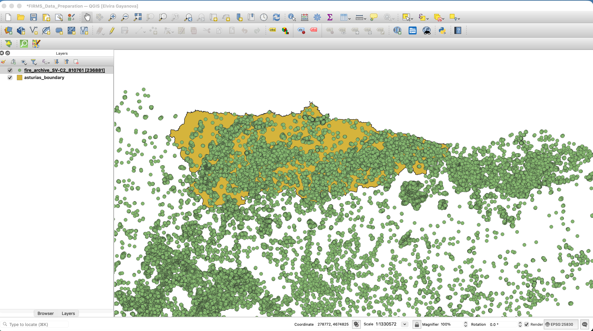

The plan was a simple chain: years 2012–2025 → clip to Asturias → year field → vegetation fires only.

**My own mistake.** The table of fires per year showed a row for **2026** — a year that should have been filtered out.

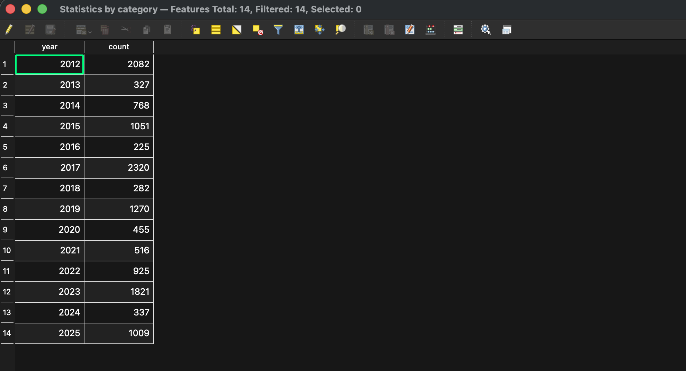

The **Processing History** gave the answer: the year filter had never run. The raw archive had been renamed as if it were filtered.

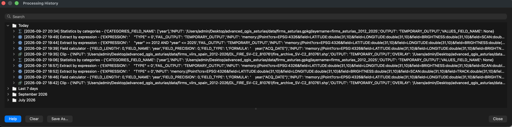

The chain was rebuilt from scratch and checked with an **exact prediction**: 13 388 fires. It matched to the unit.

| Step | Result |
|---|---|
| Archive, all Spain | 236 881 detections |
| Clip to Asturias | 32 570 |
| Years 2012–2025 | 31 668 (902 from 2026 removed) |
| Vegetation fires, `TYPE = 0` | 13 388 |
| Steelworks belt removed (chapter 7) | **12 585** |

**Lesson:** rename a layer only after checking it is the output you expect.

---

## Chapter 6 · 58 % of the fires are not fires

FIRMS marks each detection with a type. `TYPE = 2` means *static land source*: a place that is hot every year.

**18 280 of 31 668 detections in Asturias (58 %)** are static sources. They cluster on the industrial coast.

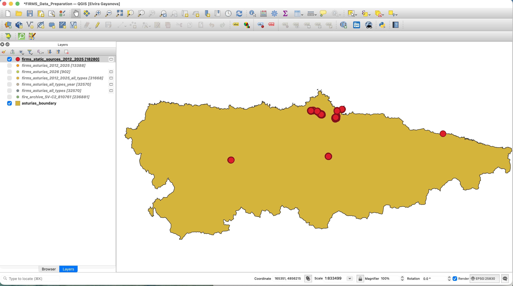

Without this filter, factories would "burn" in every frame of the animation.

---

## Chapter 7 · The fire that never moves

After the filter, the animation still had one suspect: a hot spot on the coast at the base of Cabo Peñas, between Avilés and Gijón. **It appeared in all 14 yearly frames, in the same place**, red in 2013, 2014, 2016, 2020, 2021 and 2024.

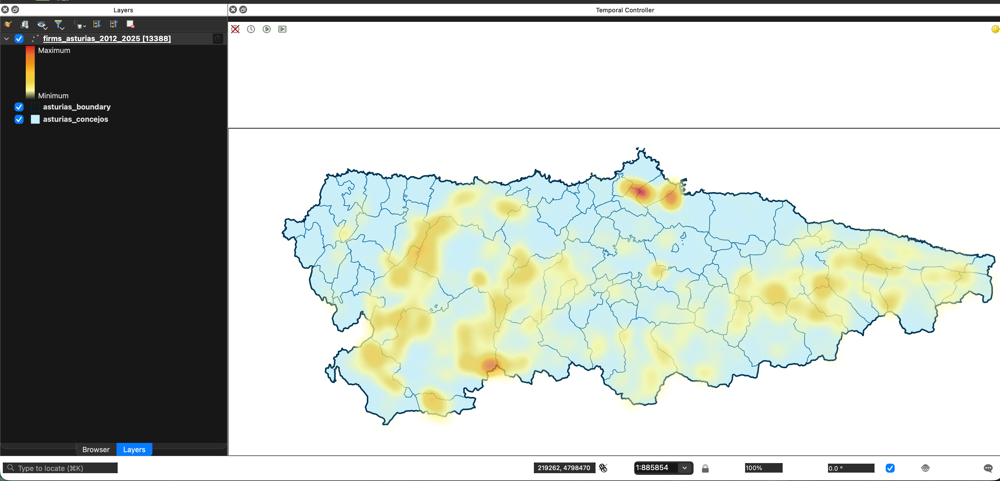

Wildfires move from year to year. This one did not.

**The interrogation.** No drawing, just a rectangle in the attribute table: latitude 43.50–43.58, longitude −5.95…−5.65.

| | Coast rectangle | All Asturias |
|---|---|---|
| detections | 803 | 13 388 |
| at night | **93 %** | 68 % |
| night detections per year | **42–76, flat** | 225 → 2 320 |
| in 2017 and 2023, the worst fire years | 49 and 46 — **no change** | peaks |

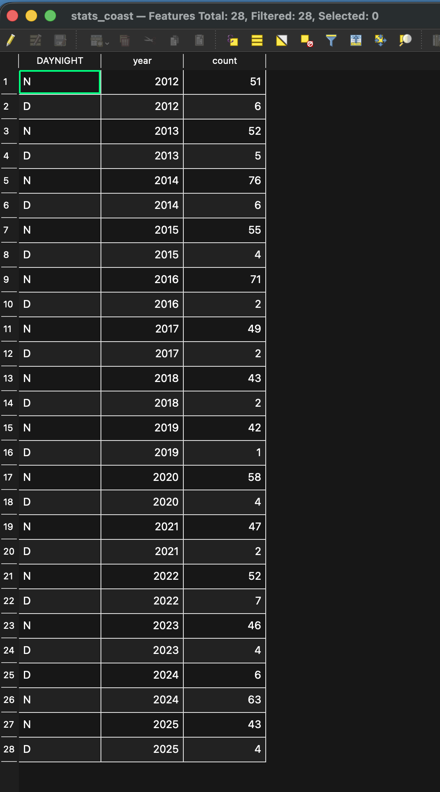
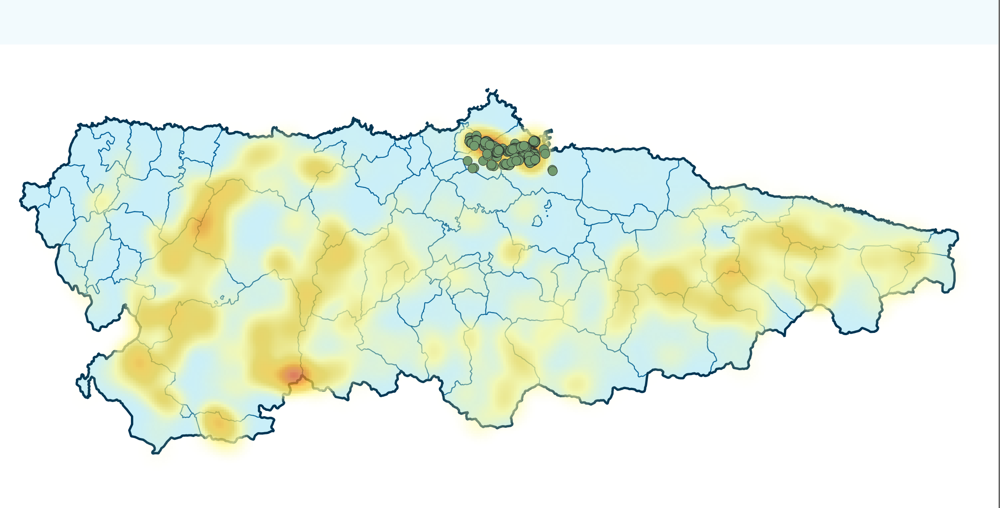

Three independent signs point to a heat source that burns **day and night, every year, regardless of the weather**: the blast furnaces of the ArcelorMittal steelworks between Avilés and Gijón. I know that place: the flame there really never goes out.

The 803 points were removed. Check per year: the removed points match the coast table exactly (2012: 57, 2013: 57, 2016: 73, 2025: 47). In quiet 2016 the steelworks produced **a third** of all "fires" in Asturias.

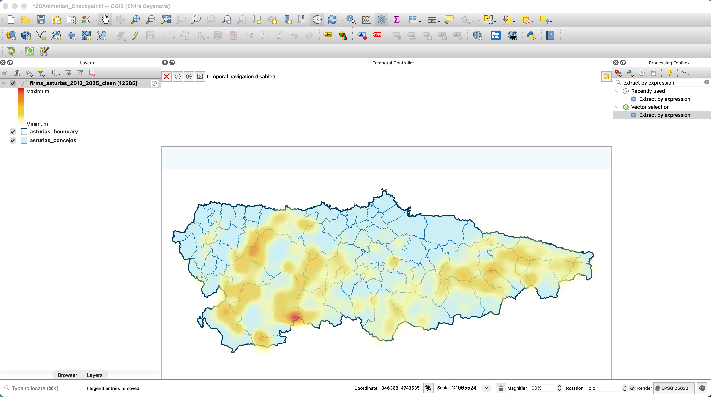

> **Lesson for anyone using official satellite data:** a provider's quality flag is a starting point, not a guarantee. Ask what the data physically are.

---

## Chapter 8 · Two maps, two stories
*Course 4.1 (heatmap + Temporal Controller), challenge 4.1.1 (weights), 4.2 (export), 4.3.1 (GIF).*

### Map 1 — how many


### Map 2 — how much energy
Challenge 4.1.1 weights the heatmap. The course uses the type of pirate attack; here the weight is physical: **FRP, fire radiative power in megawatts**, measured at the moment of the satellite pass.

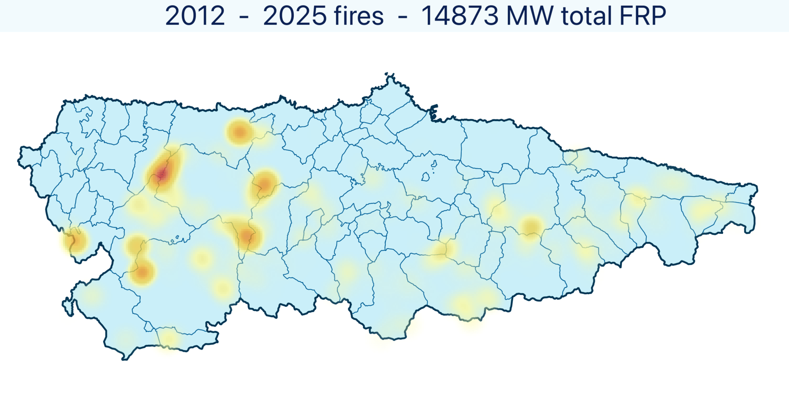

The label is not typed by hand. It is computed by `aggregate()` for every frame, so the number always matches the data.

**The twist:**

| Year | Fires | Total FRP |
|---|---|---|
| 2023 | **1 771** | 11 542 MW |
| 2025 | 962 | **19 854 MW** |

| 2023 | 2025 |
|---|---|
| 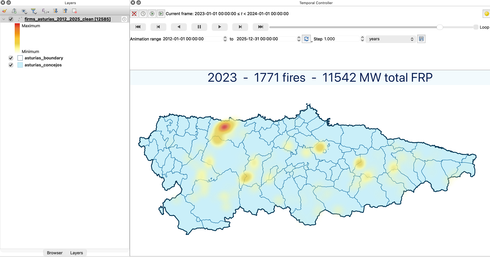 | 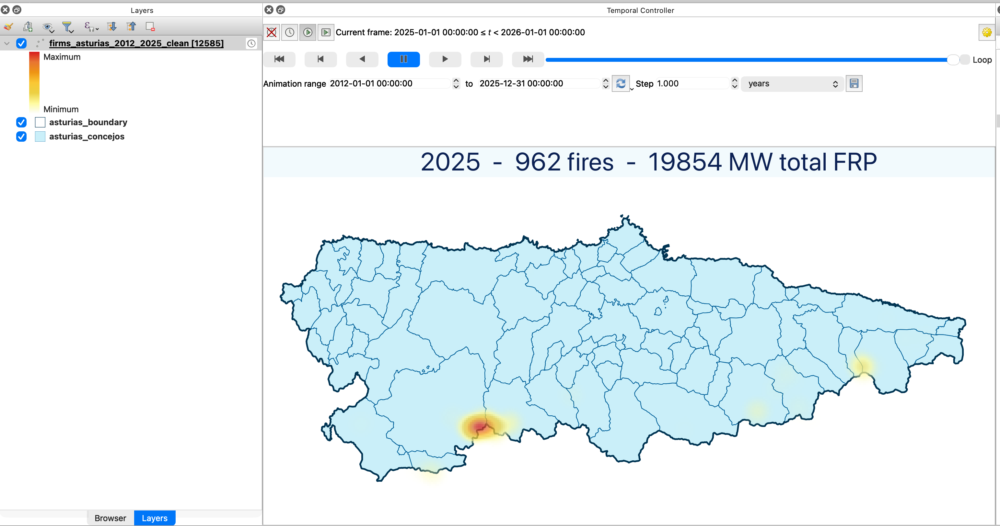 |

Half as many fires in 2025, but almost twice the energy, concentrated in one place on the south-western border with León.

### Does the satellite tell the truth?
The frames were compared with the fire record:

- **December 2015** — a winter wave of 364 fires in 57 municipalities, almost 15 000 ha; the largest started in Brañavivel (El Franco) and burned 2 554 ha. *The 2015 frame has its hot spot in the north-west.* ([RTPA](https://www.rtpa.es/noticias-asturias:La-Guardia-Civil-cree-que-el-incendio-de-El-Franco-fue-intencionado_111456481206.html))
- **October 2017** — large fires in Degaña and Ibias; schools closed in Degaña, Ibias, Allande, Cangas del Narcea and Tineo. *The reddest spots of 2017 are in the south-west.* ([elDiario.es](https://eldiario.es/sociedad/Unidad-Militar-Emergencias-Asturias-controlar_0_697480594.html), [Wikipedia](https://es.wikipedia.org/wiki/Incendios_del_noroeste_de_la_pen%C3%ADnsula_ib%C3%A9rica_de_2017))
- **Spring 2023** — 28 811 ha in 12 days; the Foyedo fire (Tineo → Valdés, over 10 000 ha) is the largest ever recorded in Asturias. *The reddest spot of 2023 is on the Valdés coast.* ([CUCC, University of Oviedo](https://cucc-uo.es/2023-ya-es-el-peor-ano-de-incendios-forestales-en-asturias/))
- **August 2025** — 18 days of fires in the south-west (Ibias, Degaña, Cangas del Narcea, Somiedo, Tineo), over 6 000 ha, provisional. *See chapter 9.* ([RTPA](https://www.rtpa.es/noticias-asturias/2025-08-29/El-incendio-de-Ibias,-ultimo-foco-activo-en-el-Principado_111756451122.html), [112 Asturias](https://www.112asturias.es/se-activa-fase-emergencia-situacion-0-infopa_2))

**A note on 2023 vs 2025:** 2023 burned far more hectares but has lower total FRP. Detections and FRP measure what the satellite sees at the moment it passes, not the burned area.

**About the colour scale:** *Maximum value* is left on *Automatic*, so each frame is scaled to its own maximum. Colour shows **where** fire concentrated in a year; the label shows **how much**.

---

## Chapter 9 · Same model, new suspects

The model from chapter 3, **unchanged**, now on 12 585 fires instead of place names.

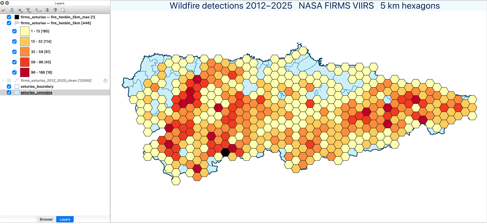

- **Balance closed exactly:** the sum of `NUMPOINTS` = 12 585. Every fire is inside a cell.
- **446 cells** with fires; median 20, maximum **188**.
- **No spatial-index warning this time.** The GeoPackage written by QGIS itself has an index; the one from Geofabrik did not. Same format, different history.

**The hottest cell** is on the border of **Cangas del Narcea and Somiedo** — exactly where the August 2025 fires burned (Genestoso in Cangas del Narcea, coming from the Orallo fire in León; Caunedo, Gúa and Perlunes in Somiedo).

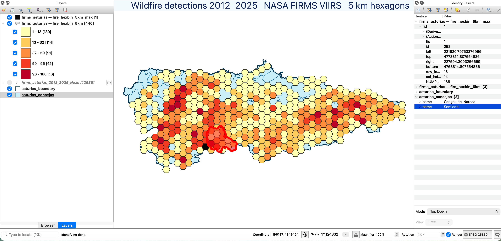

Same model, different data, different answer: the densest **names** are in Cabrales; the densest **fires** are in the south-west.

---

## Chapter 10 · Draw a corridor, get its alibi
*Course section 6.1 — aggregate expressions as default values.*

A polygon layer whose fields fill themselves: draw an area, and it reports the fires inside, their total FRP and the years they burned.

```
aggregate(layer:='firms_asturias_2012_2025_clean', aggregate:='count',
          expression:="fid", filter:=intersects(@geometry, geometry(@parent)))
```

**The trap avoided:** `aggregate()` compares geometries **without reprojecting**. The fires are in EPSG:4326, so the corridor layer was created in EPSG:4326 too. In a metric layer the answer would have been 0.

**Independent check:** *Count points in polygon* gave the same numbers.

| Area | Fires | Total FRP | Years with fires |
|---|---|---|---|
| **Pajares corridor** | **10** | 78.7 MW | 2012, 2017, 2019, 2023 |
| Area around the hottest cell | 390 | 11 505.7 MW | 2012, 2019, 2024, 2025 |

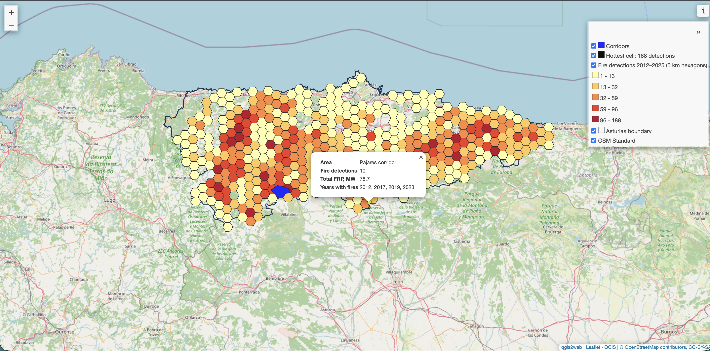

The corridor through the Pajares pass, where the motorway, the national road and the high-voltage lines cross the mountains, barely burned in 14 years. The hottest area is not a place that burns every year: it burns in rare, huge episodes.

---

## Chapter 11 · The map that refused to load

The interactive map was exported with **qgis2web** (Leaflet). It opened — and instead of the world: **"Access blocked", error 403**.

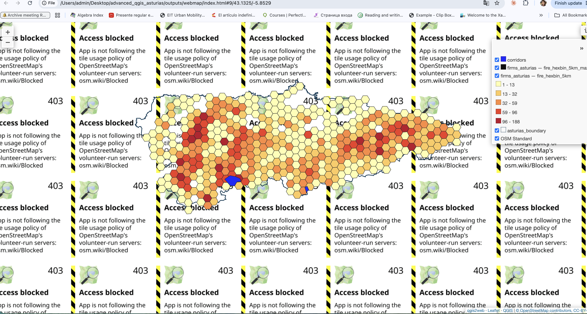

**Suspect:** the map was opened as a file (`file://`). A file has no website address, so the browser sends no *Referer*, and the volunteer-run OpenStreetMap tile servers refuse it.

**Experiment:** serve the same folder with a local web server (`python3 -m http.server 8000`) and open `http://localhost:8000`. The base map loaded. On GitHub Pages it loads too.

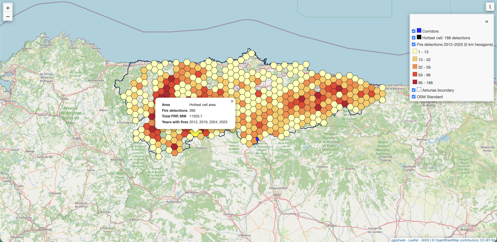

---

## Chapter 12 · Over the Pajares pass
*Course section 5 — 3D visualization (5.1), 3D fly-through (5.2) and a GIF from the frames (5.2.1).*

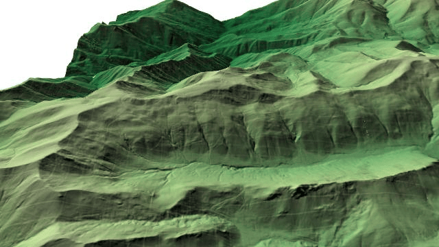

Ujaval flies over Denali with a 5 m DEM and a ready-made hillshade. I fly over the **Pajares pass**, where the motorway, the national road N-630, the old railway and two 400 kV lines cross the Cantabrian Mountains between Asturias and León. The study frame is a square of 8 × 8 km around the pass: **X 270 000–278 000, Y 4 759 000–4 767 000, EPSG:25830**.

Every step below was checked with numbers: layer information, statistics and the GDAL command that QGIS actually ran.

### 12.1 Choosing the terrain

CNIG publishes three national terrain models (MDT, *modelo digital del terreno*: bare ground, no trees or buildings). For an 8 × 8 km frame:

| Product | Cell | Cells in the frame | Size (Float32) | Note |
|---|---|---|---|---|
| MDT50 cm, 3rd LiDAR coverage | 0.5 m | 256 million | ≈ 1 GB | provisional (v1), built from the first automatic classification; coverage incomplete |
| **MDT02, 2nd LiDAR coverage** | **2 m** | **16 million** | **≈ 64 MB** | **chosen** |
| MDT05, 1st LiDAR coverage | 5 m | 2.6 million | ≈ 10 MB | coarser |

**Prediction:** the frame spans 42.95–43.02° N and crosses the 43° N parallel, a sheet boundary, so **2 sheets**. The portal found exactly 2 (MTN25 **0078-3** and **0103-1**, dated **2020**), each in two versions. I took **ETRS89-HU30** (UTM zone 30N, the working CRS), not WGS 84, so the heights are never resampled.

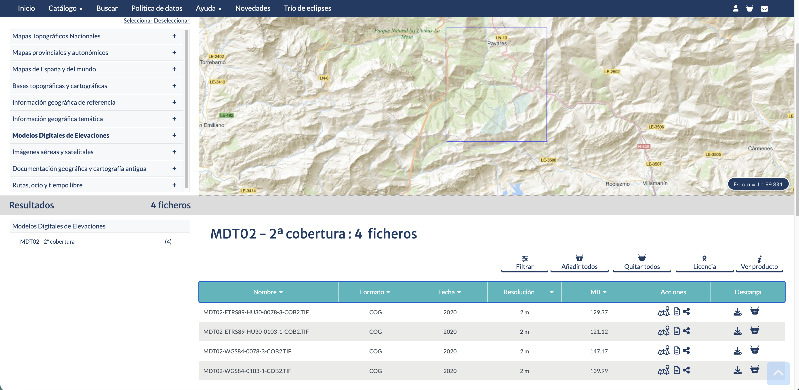

The frame itself (*Create layer from extent*): area **64 000 000 m²**, perimeter **32 000 m** — exactly 8 × 8 km. The ellipsoidal area is 63 970 777 m², 0.05 % less: the UTM scale factor at work.

### 12.2 Interrogating the two sheets

*Layer Properties → Information* for each sheet:

| | 0078-3 (north) | 0103-1 (south) |
|---|---|---|
| CRS | EPSG:25830 | EPSG:25830 |
| Cell | 2 × 2 m | 2 × 2 m |
| Size | 6 995 × 4 903 | 7 003 × 4 905 |
| X | 267 299 – 281 289 | 266 987 – 280 993 |
| Y | 4 764 267 – 4 774 073 | 4 755 011 – 4 764 821 |
| Height min / max | 412.1 / 2 028.4 m | 789.5 / 1 956.4 m |
| Mean ± SD | 1 135.3 ± 369.9 m | 1 433.2 ± 188.0 m |
| NoData / valid | −32 767 / 100 % | −32 767 / 100 % |
| Format | Float32, COG, DEFLATE | Float32, COG, DEFLATE |

- **Coverage:** together the sheets cover the frame (X 270 000–278 000 inside both; Y from 4 755 011 to 4 774 073). They overlap in a band of **554 m** (Y 4 764 267–4 764 821).
- **Grid:** all corners sit on odd metres. With a 2 m cell, the pixels of one sheet fall exactly on the pixels of the other.

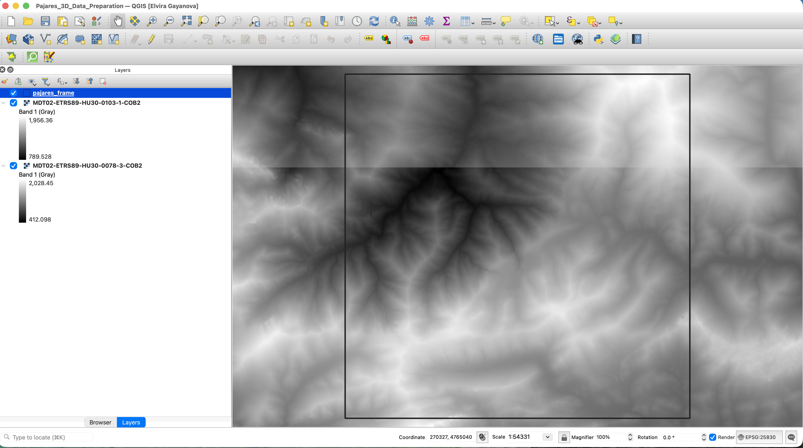

### 12.3 The seam that wasn't there

Across the frame runs a band where the grey changes. First suspect: the display — each layer stretches its own range (412–2 028 m and 790–1 956 m). The honest test is numbers, so I clicked one point in the overlap with *Identify* at 1 : 54 000:

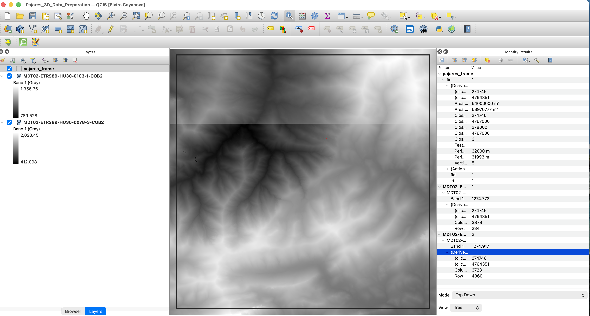

| Sheet | Column, row | Pixel centre | Height |
|---|---|---|---|
| 0078-3 | 3 723, 4 860 | 267 299 + 2·3 723 + 1 = **274 746**; 4 774 073 − 2·4 860 − 1 = **4 764 352** | 1 274.917 m |
| 0103-1 | 3 879, 234 | 266 987 + 2·3 879 + 1 = **274 746**; 4 764 821 − 2·234 − 1 = **4 764 352** | 1 274.772 m |

Same pixel, **14.5 cm apart**. I had predicted less than 1 cm. Two suspects: different LiDAR flights (a systematic offset between Asturias and León) or interpolation noise near the sheet edge.

**Experiment 1 — subtract the sheets over the whole overlap.** QGIS *Raster Calculator*, `"0078-3@1" − "0103-1@1"`, extent set by hand on the pixel grid: X 269 999–278 001, Y 4 764 267–4 764 821 → 4 001 columns × 277 rows. Check: 8 002 m / 4 001 = **2.000 m**, 554 m / 277 = **2.000 m**, so no resampling.

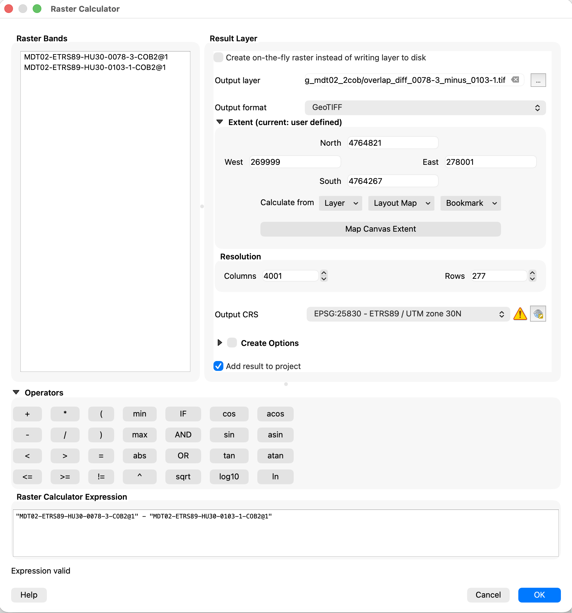

*Raster layer statistics:*

| COUNT | MIN | MAX | MEAN | STD_DEV |
|---|---|---|---|---|
| 1 108 277 (= 4 001 × 277) | 0 | 0 | 0 | 0 |

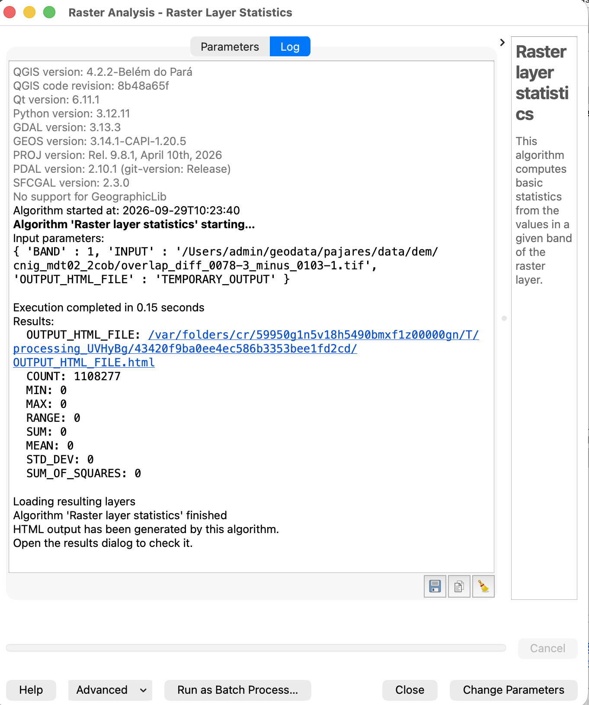

A zero where I had seen 14.5 cm is not an answer, it is a new clue. Two new suspects:

1. **Written as integers?** 0.145 would round to 0. → *Information*: **Float32**. Cleared.

   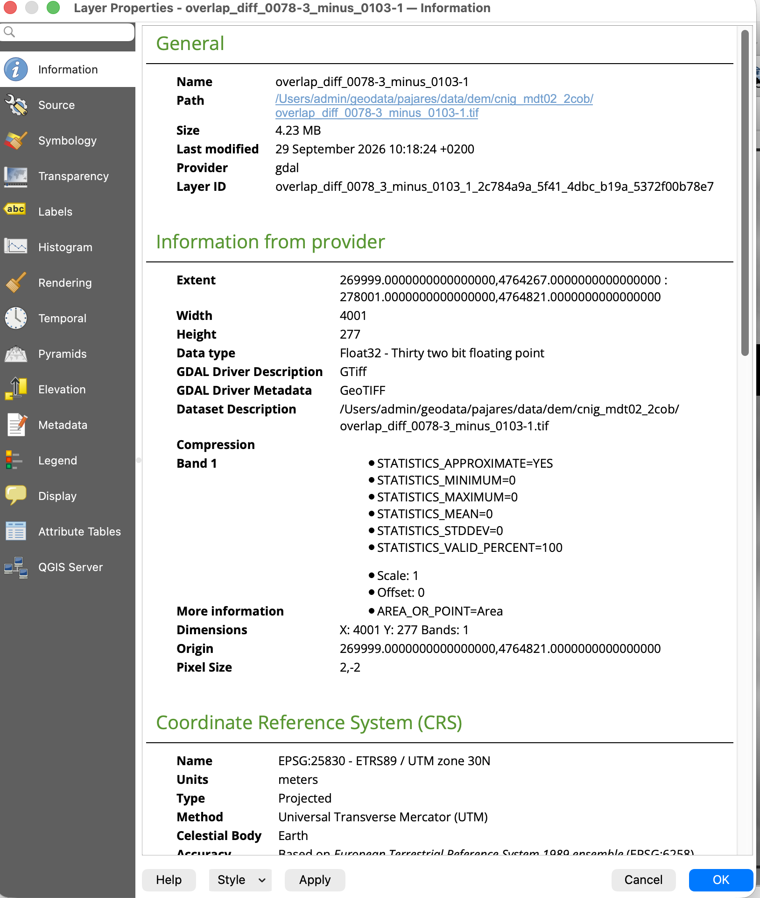

2. **A sheet subtracted from itself?** The layer names are full of hyphens. → **Experiment 2:** the same subtraction in GDAL, where the layers are file paths, not names:

   ```
   gdal_calc.py --calc "A-B" --type Float32 --NoDataValue -32767 --extent=intersect
                -A MDT02-ETRS89-HU30-0078-3-COB2.tif --A_band 1
                -B MDT02-ETRS89-HU30-0103-1-COB2.tif --B_band 1
                --outfile overlap_diff_gdal_0078-3_minus_0103-1.tif
   ```

   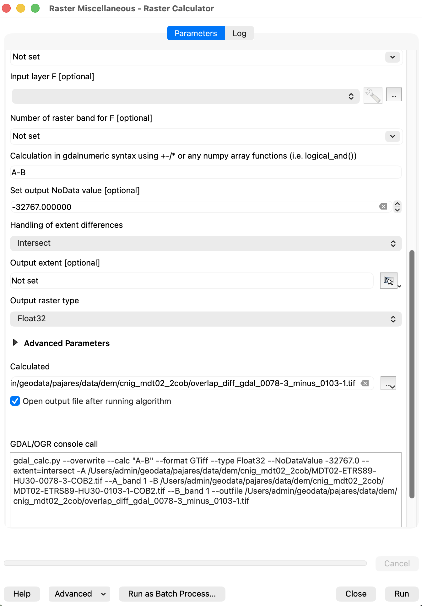
   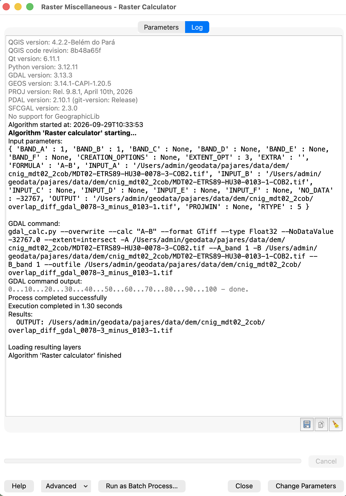

**Prediction:** the intersection of the sheets is X 267 299–280 993, Y 4 764 267–4 764 821 → (13 694 / 2) × (554 / 2) = 6 847 × 277 = **1 896 619** pixels.

| COUNT | MIN | MAX | MEAN | STD_DEV |
|---|---|---|---|---|
| **1 896 619** | 0 | 0 | 0 | 0 |

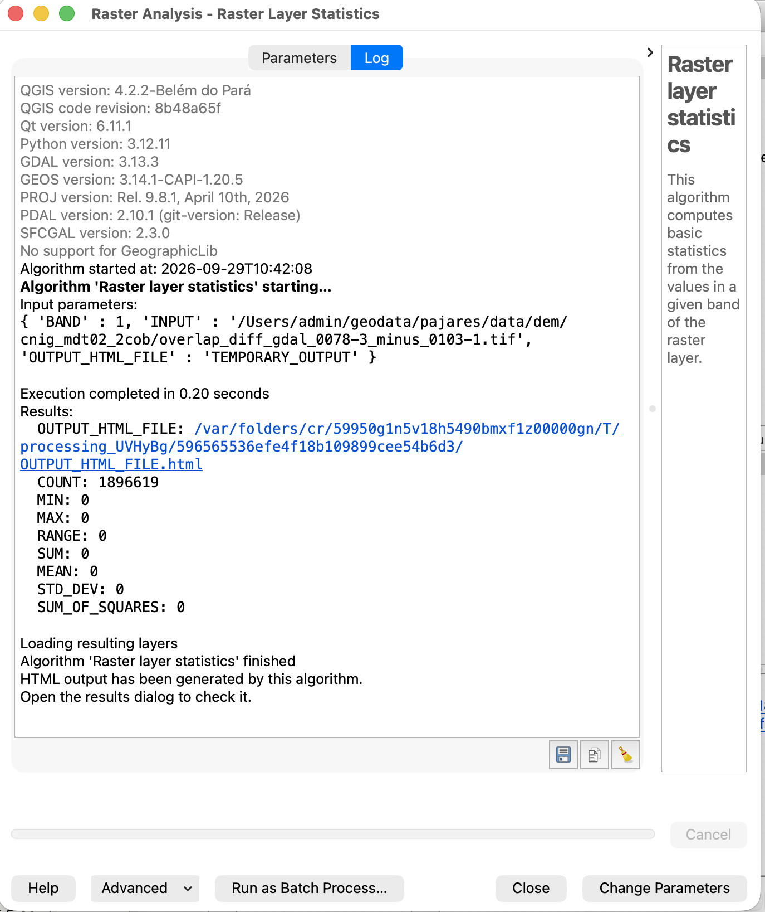

COUNT exactly as predicted, and again **every value is 0**. Two independent tools, 1.1 and 1.9 million pixels: the sheets are identical in the overlap. The calculators told the truth. The suspect is the **witness** — my click.

**Experiment 3 — the overviews.** COG files carry overviews (reduced copies for fast display: 3 498 × 2 452, 1 749 × 1 226, 875 × 613). At 1 : 54 000 one screen pixel covers about 7 × 7 terrain pixels, so *Identify* may read an overview, and each sheet builds its overviews from its own corner. I zoomed to **1 : 500** and clicked the same spot:

| Sheet | Height at 1 : 500 |
|---|---|
| 0078-3 | **1 274.948 m** |
| 0103-1 | **1 274.948 m** |

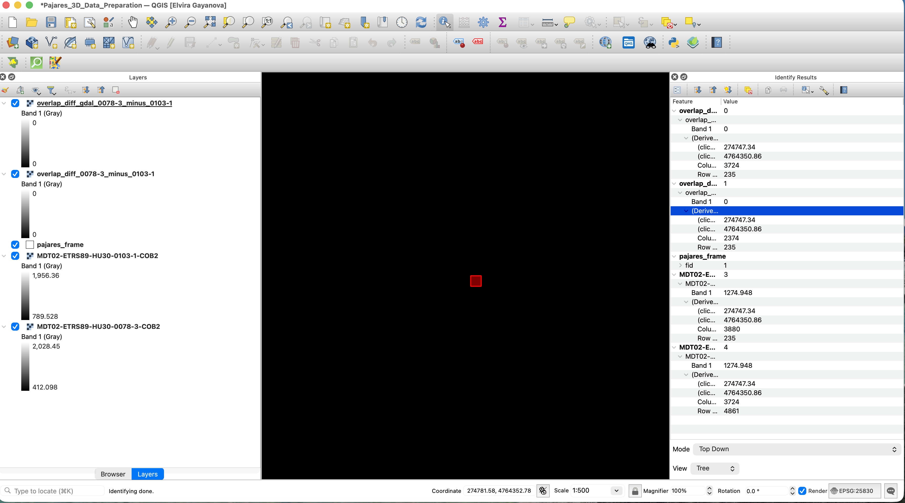

**Case closed:** there is no seam. At a small scale *Identify* was reading the overviews.

### 12.4 One terrain for the frame

**Join without copying** — a virtual raster:

```
gdalbuildvrt -resolution average -r nearest mdt02_2cob_0078-3_0103-1.vrt
             MDT02-ETRS89-HU30-0078-3-COB2.tif MDT02-ETRS89-HU30-0103-1-COB2.tif
```

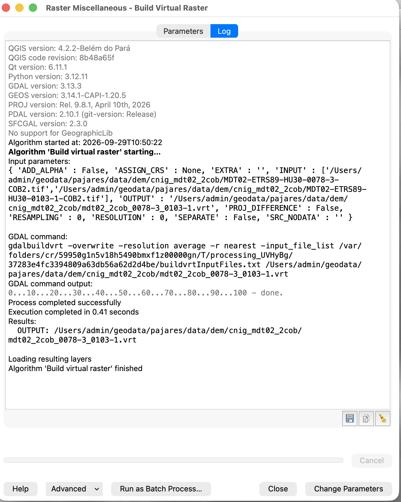

**Cut and compress** (*Clip raster by extent*, extent from the frame layer):

```
gdal_translate -projwin 270000 4767000 278000 4759000 -a_nodata -32767
               -co COMPRESS=DEFLATE -co PREDICTOR=3 -co ZLEVEL=9
               mdt02_2cob_0078-3_0103-1.vrt pajares_mdt02_2m.tif
```

The VRT is 7 151 × 9 531 pixels; `PREDICTOR=3` is the DEFLATE predictor for floating-point data.

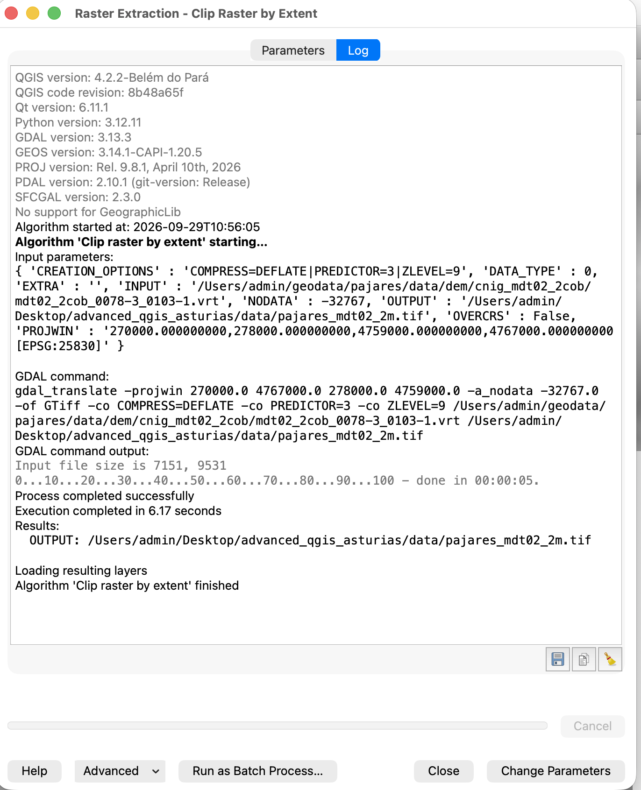

| Check | Prediction | Result |
|---|---|---|
| Size | 4 000–4 001 px | **4 001 × 4 001** |
| Extent | frame ± 1 m | 269 999–278 001 / 4 758 999–4 767 001 (the frame edge falls mid-pixel, GDAL keeps whole pixels) |
| Cell, type | 2 m, Float32 | 2 m, Float32, DEFLATE |
| File size | 20–40 MB | **30 MB** (61 MB uncompressed) |
| Heights | ≈ 1 000–2 000 m | **703.8–2 028.6 m**, mean 1 389.2 ± 281.2 m |

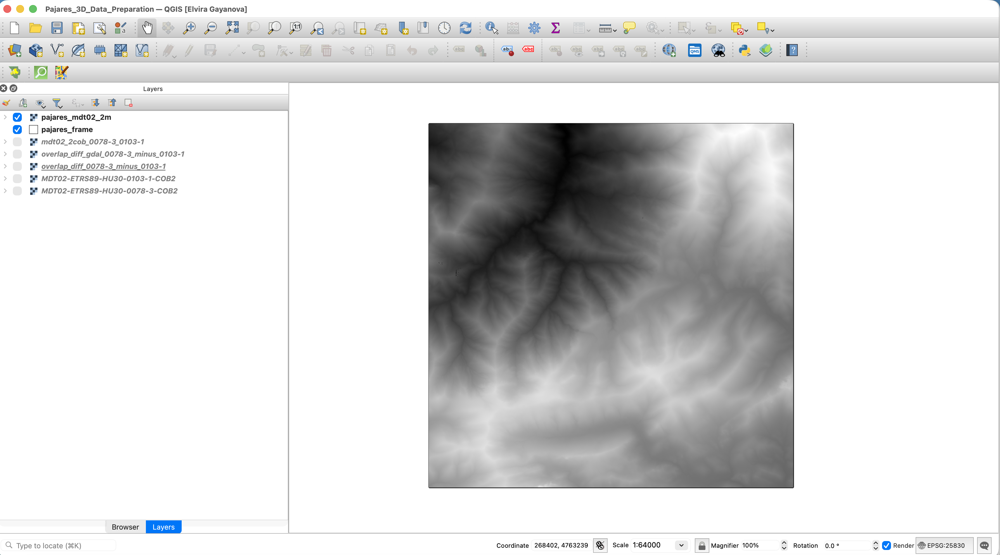

My height prediction was wrong at the bottom: the Asturian valley in the north drops to about **700 m**. **1 325 m of relief within 8 km.**

### 12.5 Colour, shadows, 3D (course 5.1)

- **Colour:** *Singleband pseudocolor*, min/max from the whole raster (703.768–2 028.623 m), ramp YlGn **inverted**: dark green valleys, pale ridges and summits. My first version was the other way round and read wrong.
- **Shadows:** a copy of the same layer with the **Hillshade** renderer (azimuth 315°, altitude 45°, Z factor 1: heights and coordinates are both in metres), blending mode **Multiply**, as in the course. No separate hillshade file.
- **Resampling test:** I tried Bilinear and Cubic instead of Nearest Neighbour to remove a fine ripple. The ripple got stronger, so the default stayed.

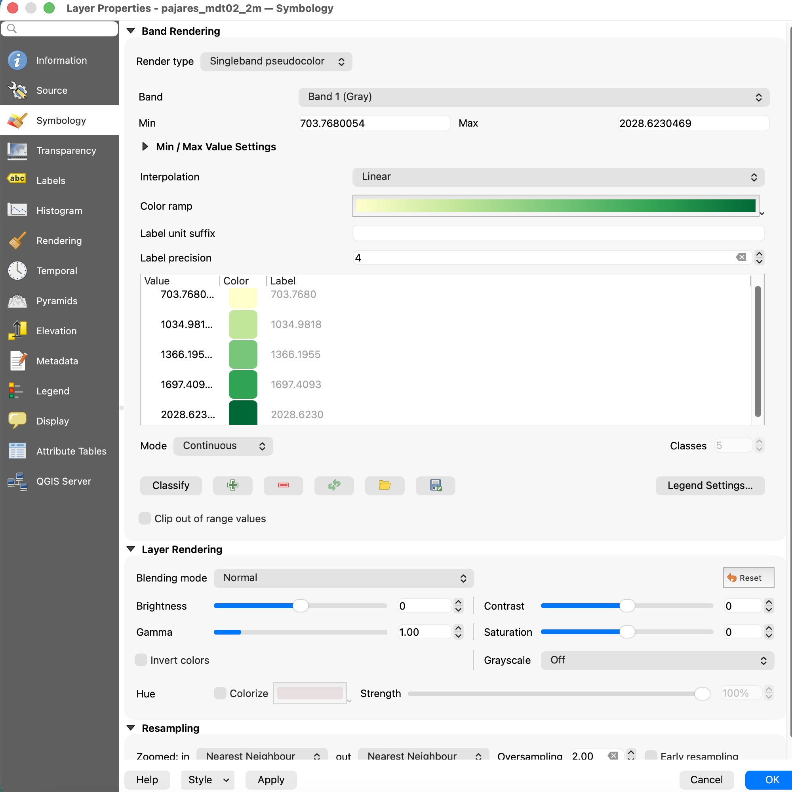
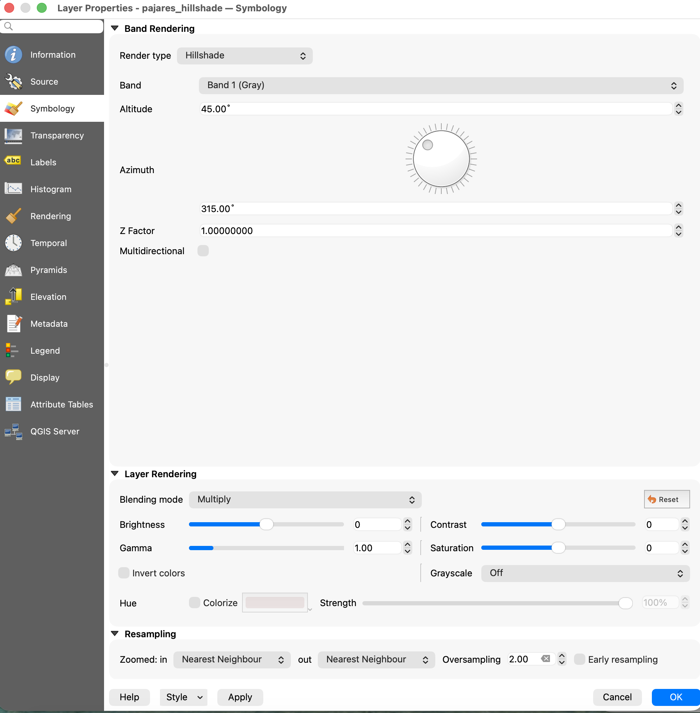
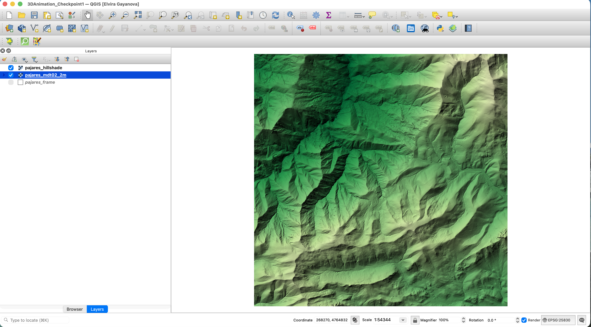

**3D view:** terrain *DEM (Raster Layer)*, vertical scale **1** (no exaggeration: the pass is steep enough), tile resolution **64 px**.

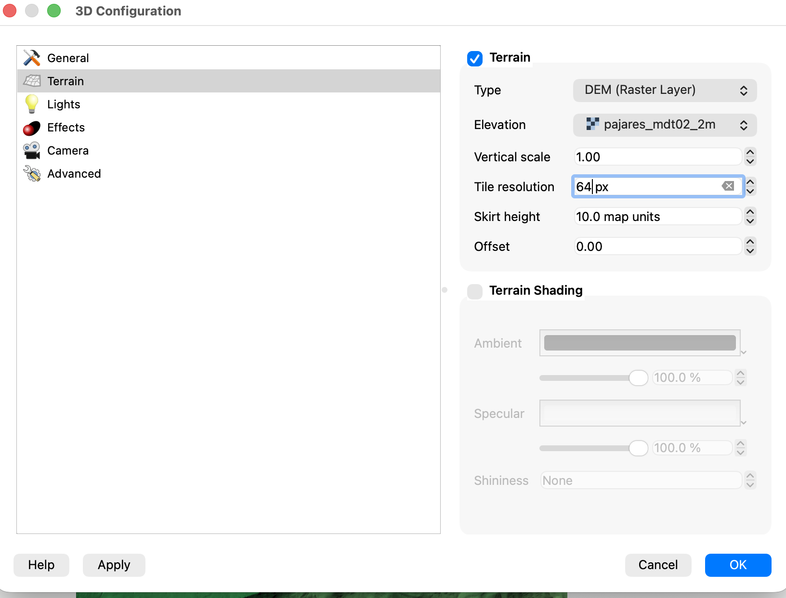
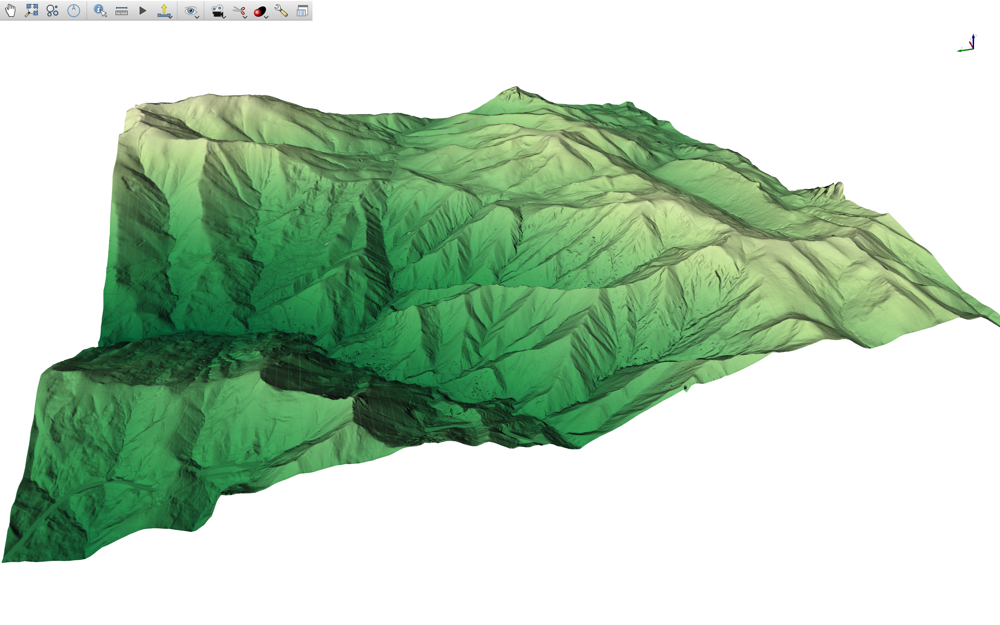

### 12.6 The fly-through and its GIF (course 5.2, 5.2.1)

Keyframes from the Asturian valley up to the ridge of the pass: **6 s** at 10 frames per second = **61 frames** (0 s included).

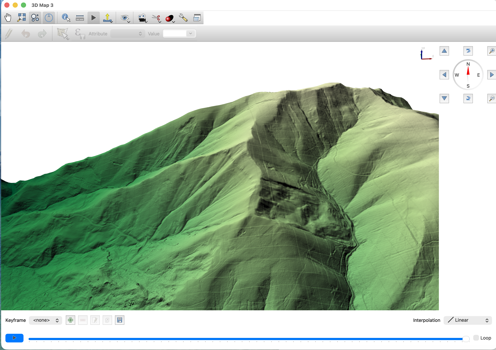

**The size trap.** The fire GIFs in chapter 8 were about 4 MB, so I predicted 4–8 MB. Reality:

| Frames | GIF | Verdict |
|---|---|---|
| 960 × 540 | **20.3 MiB** | too heavy for a README |
| 960 × 540, compressed to a target size | small | relief turned muddy |
| **640 × 360**, rendered by QGIS | **9.47 MiB**, 61 frames, 6.1 s | **kept** |

Shaded relief is fine texture in every frame, and GIF compresses it badly. The clean solution was to **render smaller frames in QGIS**, not to shrink the GIF afterwards.

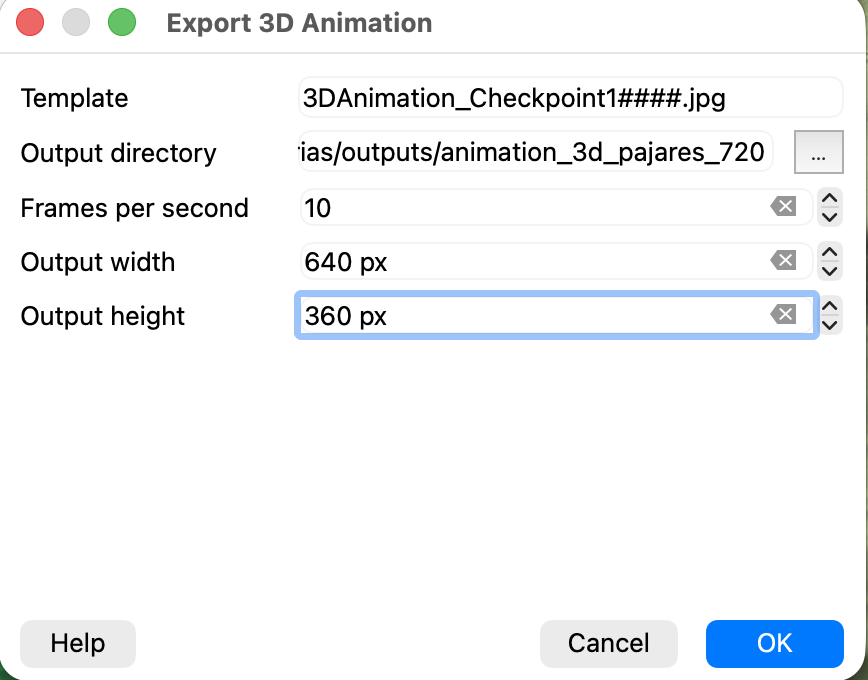


---

## Lessons from this case

1. Check the **order of magnitude** of every length and area: `0.0000…` means degrees.
2. Set the project CRS **and** the ellipsoid before loading data.
3. Before deciding a count is wrong, check **what** is being counted.
4. Rename a layer only after checking it is the output you expect.
5. A provider's quality flag is not a guarantee.
6. The same file format can come with or without a spatial index. Check, don't assume.
7. Expressions that compare geometries do not reproject. Keep the layers in the same CRS.
8. *Identify* on a raster at a small scale may read the overviews. Zoom to pixel scale before comparing values.
9. A zero is a result to question too. When two independent tools agree, check the witness that disagrees.
10. Render frames at the final size. Shrinking a GIF afterwards costs more quality than rendering it small.

---

## Case closed · What the mistakes taught me

I started with raw data and a course built on clean ones. Almost every chapter above began with a result that looked right and was not, or looked wrong and was right. This is what that left me with.

### What I can do now

| Skill | Where in this case |
|---|---|
| Clean raw OpenStreetMap data: empty strings are not NULL, lengths belong on the ellipsoid | Chapter 1 |
| Process many layers and reproject them in one batch run | Chapter 2 |
| Build a model once and reuse it on any data | Chapters 3, 9 |
| Package a whole project inside one GeoPackage | Assignment |
| Interrogate satellite data before trusting it | Chapters 5–7 |
| Animate time and weight it by a physical quantity | Chapter 8 |
| Make attributes that calculate themselves | Chapter 10 |
| Publish an interactive web map | Chapter 11 |
| Choose, check, join and clip terrain; fly over it in 3D | Chapter 12 |
| Read the GDAL command behind every tool | Chapter 12 |

### How I work now

1. **Predict the number** before running the tool. A wrong prediction is the cheapest clue there is.
2. **Close the balance** after every selection and aggregation.
3. When two explanations fit, **design the experiment** that separates them.
4. **The eye finds where to look. The numbers decide.**

### The verdict: QGIS or code?

**Where QGIS beat a script in this case:**
- **First contact with unknown data.** I saw the steelworks on the fire map because I know the place. No filter would have told me.
- **Time as movement.** Fourteen years of fires, watched frame by frame, without a line of code.
- **Attributes that update as you draw.** A corridor reports its own fires.
- **Terrain in 3D** from my own DEM, in minutes.
- **Transparency.** The Processing log shows the exact GDAL command, ready to reuse in a script.

**Where the eye was not enough:** the seam that wasn't there and the 14.5 cm that were overviews. The picture lied twice; the numbers settled it both times.

**Honestly:** Python would do many of these steps faster the second time. It would not have shown me, the first time, where the data were lying.

### When to use this way of working

**Use it for:**
- a new dataset, especially satellite or open data;
- checking quality before building anything on the data;
- work where local or domain knowledge matters;
- one-off analysis and prototyping a pipeline;
- explaining results to people who don't code.

**Use code for:**
- scheduled or repeated processing;
- thousands of files;
- machine learning;
- anything that must live in version control with tests.

**Best of both:** explore and check in QGIS, take the command from the log, scale it in Python.

---

## Reproduce it

```
data/        derived GeoPackages: asturias.gpkg, lena.gpkg, modelar.gpkg,
             firms_asturias.gpkg, corridors.gpkg, assignment/,
             pajares_frame.gpkg, pajares_mdt02_2m.tif (CNIG MDT02 clipped to the frame, 30 MB)
models/      hexbin_density.model3, assignment model
solutions/   one QGIS project per step (relative paths);
             Pajares_3D_Data_Preparation.qgz also needs the two CNIG sheets (below)
outputs/     screenshots/, gif/, animation_count_clean/, animation_frp_clean/,
             animation_3d_pajares_640/,
             webmap/, tables (.csv)
assignment_elvira_gayanova/   the submitted assignment: project inside one GeoPackage (course 3.3)
```

**Not included (too large, re-downloadable):**
- `asturias_osm_free_2026-09-15.gpkg` (133 MB) and `asturias_osm_2026-09-15.osm.pbf` — Geofabrik, Asturias, 2026-09-15: https://download.geofabrik.de/europe/spain/asturias.html
- NASA FIRMS archive, VIIRS S-NPP 375 m, Spain, 2012-01-20 → 2026-09-22: https://firms.modaps.eosdis.nasa.gov/download/
- CNIG MDT02 2nd coverage, sheets MDT02-ETRS89-HU30-0078-3-COB2 and MDT02-ETRS89-HU30-0103-1-COB2 (129 MB and 121 MB): https://centrodedescargas.cnig.es

---

## Notes sent to the course authors
1. **1.1.1:** Geofabrik GeoPackages store a missing name as an empty string; `is not null` keeps every feature.
2. **1.2:** *Sum line lengths* inherits the project ellipsoid; with `None` it silently returns degrees.
3. **2.1.1:** QGIS 4.2 batch mode has no *Save to GeoPackage*; workaround: *Package Layers*.

## Credits
- Course material: *Advanced QGIS Course* by Ujaval Gandhi, [spatialthoughts.com](https://spatialthoughts.com), CC BY 4.0.
- Map data © OpenStreetMap contributors, ODbL.
- Terrain: Obra derivada de MDT02-cob2 2015-2021 CC-BY 4.0 scne.es
- *We acknowledge the use of data and/or imagery from NASA's Fire Information for Resource Management System (FIRMS) (https://earthdata.nasa.gov/firms), part of NASA's Earth Science Data and Information System (ESDIS).*
